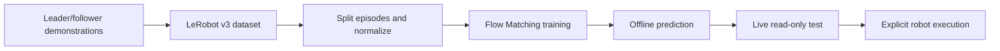

# SO101 Learning-Based Arm Control

An experimental workflow for **SO101 visual imitation learning**: collect real
demonstrations, train a conditional Flow Matching action policy, and deploy it
with live wrist-camera observations and joint feedback.

The Hiwonder HX-30HM hardware path has been exercised on a real leader/follower
pair. A configurable STS3215 path is included but has **not been physically
validated in this project**. This repository replaces the earlier Panda/MuJoCo
prototype; that version remains available in Git history.

[中文指南](docs/README.zh-CN.md) · [Hardware setup](docs/hardware.md) ·
[Data and training](docs/training.md) · [Attribution](THIRD_PARTY_NOTICES.md)

## What is implemented

| Stage | Implementation |
|---|---|
| Hardware | Explicit serial ports, calibration IDs and HX-30HM/STS3215 driver selection |
| Collection | LeRobot v3 episodes, wrist RGB, joint states/actions, append/resume |
| Conversion | Episode-level train/validation split; normalization fitted on training episodes only |
| Policy | ViT visual features + joint state → conditional Rectified Flow → 16-step action chunk |
| Training | Offline imitation learning, EMA, validation, checkpointing and resume |
| Deployment | Read-only by default; explicit execution; slew limits, raw encoder bounds, status checks |
| Validation | Synthetic end-to-end tests and simulated hardware regression tests |

The policy/model code is adapted from [ReinFlow](https://github.com/ReinFlow/ReinFlow)
with retained licenses. This is its **imitation-learning stage**. Language/VLA
conditioning and online reinforcement-learning fine-tuning are future work.
The integration and hardware adaptations are not presented as a new learning algorithm.



## Install

Use a separate training environment. Install the PyTorch build appropriate for
your CPU/CUDA system, then:

```bash
git clone https://github.com/CorradoZhang/Advanced-Learning-Based-Robotic-Arm-Control.git
cd Advanced-Learning-Based-Robotic-Arm-Control
python -m pip install -e '.[prepare,test]'
```

Python 3.10+ is required. Development used Linux/CUDA for training and macOS/CPU
for inference. CPU training is useful for smoke tests; a CUDA GPU is recommended
for experiments. Hardware support is an optional dependency installed separately:

```bash
# In your hardware environment, before installing this project:
python -m pip install -r requirements-hardware.txt
python -m pip install -e '.[prepare,test]'
```

The hardware requirement pins the Hiwonder LeRobot fork used by this project.
Do not replace a working robot environment with a different LeRobot release
without checking its motor interfaces and calibration compatibility.

## 1. Configure and collect

```bash
cp configs/hardware.example.yaml hardware.local.yaml
# Edit hardware.local.yaml: your actual ports, persistent calibration IDs and camera index.
python -m scripts.hardware --config hardware.local.yaml calibrate-leader
python -m scripts.hardware --config hardware.local.yaml calibrate-follower
python -m scripts.hardware --config hardware.local.yaml teleoperate
python -m scripts.hardware --config hardware.local.yaml record \
  --name pick_place --episodes 30 \
  --task 'Pick up the object and place it in the container.'
```

Recording uses 640×480 RGB at 30 FPS, with episodes up to 30 seconds and 15 seconds
for scene reset. The dataset is saved under `datasets/pick_place/`. Existing
directories are never overwritten. To append **10 additional** episodes:

```bash
python -m scripts.hardware --config hardware.local.yaml record \
  --resume datasets/pick_place --episodes 10 \
  --task 'Pick up the object and place it in the container.'
```

Close other camera/serial users first. On macOS, keyboard shortcuts may require
Accessibility/Input Monitoring permission for your terminal. See [hardware setup](docs/hardware.md).

## 2. Prepare and train

```bash
python -m runner.flow_matching.prepare \
  --dataset datasets/pick_place --out data/pick_place --val-episodes 3

python -m runner.flow_matching.train \
  --data data/pick_place --device cuda:0 --epochs 200 --batch-size 64
```

All episodes in `--dataset` belong to this experiment. With 30 episodes and
`--val-episodes 3`, the split is 27 training + 3 validation episodes. No other
dataset is implicitly included. Transfer the prepared directory and code to a
training server if collection and training use different machines.

Each run creates `result/flow_matching/<timestamp_seed>/` containing:

```text
config.yaml                 # exact architecture and experiment settings
normalization.npz           # statistics for this training split
manifest.json               # episode split, joint order and units
metrics.jsonl
train.log
checkpoint/
  best_val.pt               # raw model selected by validation FM loss
  last.pt                   # raw/EMA models, optimizer and scheduler state
  state_N.pt
```

Validation FM loss is not a grasp success rate. Evaluate task success on the
actual robot. Small single-task datasets establish a baseline, not broad generalization.

## 3. Inspect a checkpoint offline

Replace `YOUR_RUN` with an actual output directory:

```bash
python -m runner.flow_matching.predict \
  --run result/flow_matching/YOUR_RUN --data data/pick_place/val.npz --device cpu
```

The output is a 16×6 action chunk in native LeRobot units: **degrees for the first
five joints; calibrated 0–100 position for the gripper**. Gripper values are not
angles, and the demonstrated action range need not cover the full 0–100 scale.

## 4. Deploy

Copy the **entire run bundle**, not just `best_val.pt`, to the robot computer.
Use the same joint calibration and camera mounting/preprocessing as collection.
Replace `YOUR_PORT` with the actual follower port and use its calibrated ID.

```bash
# Live observations and predictions only; no goal-position or torque configuration writes.
python -m deployment.deploy --run result/flow_matching/YOUR_RUN \
  --port YOUR_PORT --robot-id follower --motor-model hx30hm

# Explicitly enable execution after inspecting the read-only behavior.
python -m deployment.deploy --run result/flow_matching/YOUR_RUN \
  --port YOUR_PORT --robot-id follower --motor-model hx30hm --execute --duration 5
```

Camera preview is on by default; use `--no-preview` in headless mode. Deployment
defaults to 30 seconds and replans after executing the first action of each chunk.
Ctrl+C or closing the preview requests a stop. The controller attempts torque
release on exit; support the arm before stopping. A reported servo fault can
prevent confirmation of release. Software checks are not a hardware emergency stop.

Standalone diagnostics and release do not require model files:

```bash
python -m deployment.deploy --port YOUR_PORT --robot-id follower --diagnose
# Support the arm and unload the gripper before releasing torque:
python -m deployment.deploy --port YOUR_PORT --robot-id follower --release
```

## Layout

```text
algorithm/flow_matching/    # model, visual encoder, dataset and offline trainer
runner/flow_matching/       # conversion, training and offline prediction CLIs
deployment/                # live controller and regression tests
scripts/                   # hardware setup, collection, optional camera preview
configs/                   # portable model and hardware templates
docs/                      # workflow, units and known issues
tests/                     # hardware-free pipeline tests
```

## Tests and known limitations

```bash
python -m pytest
```

Tests do not open serial ports or cameras. Some simulated hardware tests require
the optional LeRobot package and are skipped when it is absent. No dataset,
trained checkpoint, device calibration, private serial identifier or measured
task-success claim is included in this release.

Known limitations include intermittent macOS/USB camera stalls, gripper overload
under sustained contact, and dependence on initial pose/camera viewpoint. The
controller detects faults but does not eliminate their mechanical causes. It
does not automatically home/reset the robot. See [troubleshooting](docs/hardware.md#troubleshooting).

## Attribution and license

Project integration code is MIT licensed. Upstream model/helper copyrights and
licenses remain in their files and `algorithm/flow_matching/LICENSE-ReinFlow`.
See [THIRD_PARTY_NOTICES.md](THIRD_PARTY_NOTICES.md) for ReinFlow, LeRobot, Hiwonder,
IBRL/D3IL helpers and the scheduler provenance.

ReinFlow paper: [Fine-tuning Flow Matching Policy with Online Reinforcement Learning](https://arxiv.org/abs/2505.22094).
