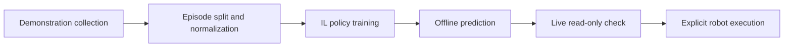

# Advanced Learning-Based Robotic Arm Control

An experimental project for learning-based robotic arm control, connecting real
robot demonstrations, policy training, offline evaluation and physical deployment.
Code is organized by learning category. The current implementation is **visual
Flow Matching imitation learning (IL) on SO101**.

[中文指南](docs/README.zh-CN.md) · [Flow Matching workflow](docs/il/flow_matching.md) ·
[Hardware setup](docs/hardware.md) · [Data and training](docs/training.md)

## Current implementation

| Category | Method | Available workflow |
|---|---|---|
| Imitation learning (IL) | Visual Flow Matching | Collection, data conversion, training, validation and deployment |

The model is adapted from [ReinFlow](https://github.com/ReinFlow/ReinFlow), with
retained attribution and licenses. This project currently implements its
imitation-learning/pretraining stage. See [third-party notices](THIRD_PARTY_NOTICES.md).

Hiwonder HX-30HM leader/follower hardware has been exercised during development.
STS3215 selection is available through the hardware adapter, but has not been
physically validated in this project. The current data/policy path expects six
joint coordinates and one wrist RGB camera; it is not a general robot interface.

## Workflow



## Installation

Use a dedicated training environment with Python 3.10+ and a suitable PyTorch
CPU/CUDA build:

```bash
git clone https://github.com/CorradoZhang/Advanced-Learning-Based-Robotic-Arm-Control.git
cd Advanced-Learning-Based-Robotic-Arm-Control
python -m pip install -e '.[prepare,test]'
```

For physical collection/control, install the optional pinned Hiwonder LeRobot
fork in your hardware environment before installing this project:

```bash
python -m pip install -r requirements-hardware.txt
python -m pip install -e '.[prepare,test]'
```

Development used Linux/CUDA training and macOS/CPU inference. Hardware and
training environments may be separate. Check driver/calibration compatibility
before replacing an existing working robot environment.

## Quick start

Copy `configs/hardware.example.yaml` to `hardware.local.yaml` and set your own
serial ports, calibration IDs and camera index. Local device settings are ignored
by Git. Calibrate and test teleoperation before collecting demonstrations:

```bash
python -m scripts.hardware --config hardware.local.yaml calibrate-leader
python -m scripts.hardware --config hardware.local.yaml calibrate-follower
python -m scripts.hardware --config hardware.local.yaml teleoperate
python -m scripts.hardware --config hardware.local.yaml record \
  --name pick_place --episodes 30 \
  --task 'Pick up the object and place it in the container.'
```

Prepare only the chosen dataset, then train the IL policy:

```bash
python -m runner.il.flow_matching.prepare \
  --dataset datasets/pick_place --out data/pick_place --val-episodes 3
python -m runner.il.flow_matching.train \
  --data data/pick_place --device cuda:0 --epochs 200 --batch-size 64
```

With 30 episodes, this example uses 27 for training and 3 for validation. Splits
are made by episode; normalization uses training episodes only. New runs go to
`result/il/flow_matching/<timestamp_seed>/` and include the checkpoint, resolved
configuration, normalization statistics, manifest and metrics.

Inspect the model offline before connecting it to a robot. Replace `YOUR_RUN`
with an actual training output directory:

```bash
python -m runner.il.flow_matching.predict \
  --run result/il/flow_matching/YOUR_RUN --data data/pick_place/val.npz
```

Copy the complete run bundle to the robot computer. Replace `YOUR_PORT` and use
the same follower calibration ID and camera mounting as collection:

```bash
# Default: read-only predictions, camera preview, maximum 30 seconds.
python -m deployment.deploy --run result/il/flow_matching/YOUR_RUN \
  --port YOUR_PORT --robot-id follower

# Explicitly enable a short physical test after inspecting read-only behavior.
python -m deployment.deploy --run result/il/flow_matching/YOUR_RUN \
  --port YOUR_PORT --robot-id follower --execute --duration 5
```

The first five action coordinates are degrees; the gripper is calibrated 0–100,
not an angle. Deploy with the checkpoint's matching config, normalization and
manifest. The runtime requests a stop on Ctrl+C/preview closure and attempts
per-motor torque release. Support the arm before stopping; software protection
is not a hardware emergency stop.

## Project structure

```text
il/flow_matching/              # Policy, visual network, dataset and IL trainer
runner/il/flow_matching/       # Data conversion, training and prediction CLIs
configs/il/flow_matching.yaml  # Model/training defaults
configs/hardware.example.yaml # Hardware template
scripts/                      # Calibration, teleoperation, collection, camera preview
deployment/                   # Physical inference and control protection
tests/                        # Hardware-free workflow tests
docs/                         # Method, hardware and troubleshooting documentation
```

Only implemented modules are included. The current SO101 pipeline is the first
working application; new learning methods can be added when implemented without
relabeling the existing IL policy.

## Documentation

- [Visual Flow Matching: full workflow, model and commands](docs/il/flow_matching.md)
- [Data format, normalization, training and resume](docs/training.md)
- [Hardware configuration, diagnostics and known faults](docs/hardware.md)
- [中文使用指南](docs/README.zh-CN.md)
- [Licenses and upstream provenance](THIRD_PARTY_NOTICES.md)

## Verification and limits

```bash
python -m pytest
```

Tests cover synthetic video/Parquet conversion, CPU training, resume, checkpoint
prediction and simulated controller guards. They do not actuate hardware. No
recordings, weights, run artifacts or device calibration files are shipped.

Camera stalls, gripper overload under sustained contact and dependence on pose
and viewpoint remain experimental limitations. Validation loss is not a task
success rate. The software detects faults but does not remove their physical
causes, automatically reset the arm, or establish broad task generalization.

Project integration code is MIT licensed; original notices are retained in the
IL implementation. Earlier Panda/MuJoCo prototype code remains in Git history.
